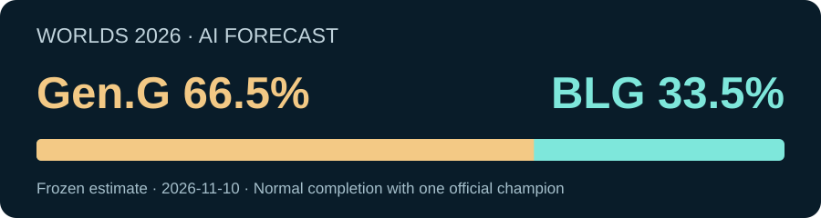

# AI Prediction Journal002: Worlds2026, Gen.G or BLG?

[← All episodes](../README.en.md) · [中文](issue-002.md)

**Selected estimate: GEN66.5%, BLG33.5%.**

Conditional on normal completion of the specified BO5 with one official champion. Cancellation or unresolved status is not automatically a defeat. This article summarizes the existing frozen estimate without changing it.

## Why favor GEN?

GEN is5–0 in series and10–1 in maps at Worlds and won its three recent domestic BO5s. BLG is11–4 in maps. Opponents differ, so raw win rates are not final probabilities.

The model uses3432 historical series to estimate opponent-adjusted relative strength. Each match is counted once, without treating scores, rankings and repeated reports as independent evidence.

Calibrated Elo gives GEN approximately64.4%; the recency model gives68.6%. Their prespecified equal blend gives66.5%. They share data and are not independent evidence.

## The strongest countercase

BLG beat DK3–0 and T1 3–1 and won First Stand. GEN faced LYON and IG in knockouts and only3 distinct teams overall, versus7 for BLG. Official GPR's November9 snapshot is nearly level: BLG1611, GEN1610. Those are ratings, not official final probabilities.

## How was the probability checked?

A retrospective replay of239 completed2026 BO5s uses earlier recorded matches before each forecast. The replay's probability error is lower than an always50/50 baseline.

This is a reconstruction, not239 forecasts publicly issued before the matches. It does not prove the target's true probability. New diagnostics suggest possible overall overconfidence; international samples are sparse and do not establish a unique target correction.

## AI and market

| Team | AI estimate | Polymarket midpoint |
| --- | ---: | ---: |
| GEN |**66.5%**|62.5%|
| BLG |**33.5%**|37.5%|

Snapshot:2026-11-10T06:11:55Z, after this revision's freeze. These are whole-match best-bid/ask midpoints, not game/handicap or buy-button prices. The displayed GEN gap is about4.0percentage points. Winner equivalence requires normal completion inside the contract window; postponement/cancellation/forfeit settlement differs. The gap proves neither side superior.

## Remaining limits

Current Fearless Game5/reset, comprehensive notices, final starters/health and historical source availability/timezones remain incomplete. Full factual review has not passed. This is a conditional model estimate, not a guarantee.

## Key sources

Read on November9–10,2026; live pages can change after the archived snapshot.

1. [Official Worlds schedule](https://lolesports.com/en-GB/leagues/worlds): pairing, results and paths.
2. [LCK playoffs](https://gol.gg/tournament/tournament-matchlist/LCK%202026%20Season%20Playoffs/): GEN domestic BO5s.
3. [LPL Grand Finals](https://gol.gg/tournament/tournament-matchlist/LPL%202026%20Grand%20Finals/): BLG domestic results.
4. [First Stand](https://gol.gg/tournament/tournament-matchlist/2026%20First%20Stand/): BLG ceiling and GEN counterexample.
5. [Official GPR](https://lolesports.com/en-GB/gpr/2026/current): nearly-level November9 rating perspective.
6. [Worlds event rules](https://cdn.sanity.io/files/dsfx7636/news_live/faa5ce974e58615911fbee931c6123e2785a8b46.pdf): BO5/patch26.20; some Fearless detail remains unknown.
7. [Polymarket moneyline](https://polymarket.com/event/lol-blg-gen-2026-11-14): post-freeze external benchmark.

## Record and follow-up

Match-data cutoff2026-11-09T13:00:34Z, latest source date November8. Local freeze2026-11-10T06:09:44Z. Original GitHub evidence release2026-11-10T12:28:49Z; local freeze is not publication time.

The early heuristic provisional GEN52.1/BLG47.9 was replaced by the historical model's66.5/33.5; the targeted review retained it. Prior market exposure remains disclosed, so this is not a pristinely blind process. Market prices did not retune this estimate.

The final was unresolved when the original evidence was published. Post-event review will be separate and preserve the original judgment.

Reports and frozen records

- [English PDF](../episodes/002-lol-worlds-2026/report.en.pdf)
- [Frozen JSON](../episodes/002-lol-worlds-2026/frozen-probabilities.json)
- [Version history](../episodes/002-lol-worlds-2026/version-history.json)
- [Historical full evidence package](https://github.com/changyicheng1234/ai-prediction-evidence/releases/tag/episode-002-20261110-v3)

Existing technical archives remain available; future episodes use a concise report, key sources and frozen record. Reading the article requires no package download.

[← All episodes](../README.en.md)
