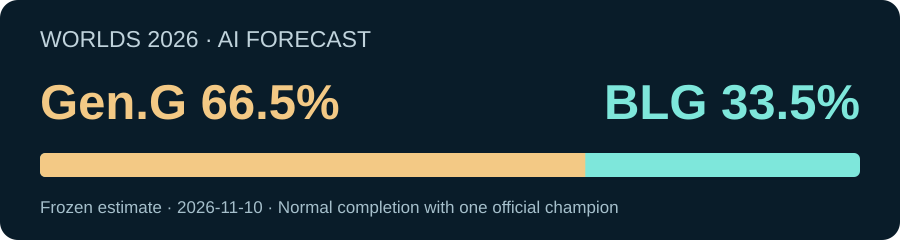

# 先见系列（第002期）：2026全球总决赛，Gen.G还是BLG？

[← 返回目录](../README.md) · [English](issue-002.en.md)

**本期预测：Gen.G 66.5%，BLG 33.5%。**

这是对双方正常完成决赛BO5、产生唯一官方冠军的估计，取消或未决不自动算任何一方输。本期文章整理自已冻结预测，没有重新改动概率。

## 为什么更看好Gen.G？

**第一，近期表现更稳定。** Gen.G本届系列赛5胜0负、小局10胜1负，近期国内三个BO5也全部获胜。BLG本届小局11胜4负。但双方对手不同，不能直接拿原始胜率当决赛胜率。

**第二，把对手实力放进计算。** 模型使用3432个历史系列赛，结合对手之间的比赛估计相对强弱。每场只计一次，不把同一场的比分、排名和报道反复当作新证据。

**第三，两种计算视角都偏向Gen.G。** Elo给出的Gen.G胜率约64.4%，近期模型约68.6%；按事先确定的各50%组合，得到66.5%。它们共享同一批比赛，并不是两份独立证据。

## BLG最有力的反方理由是什么？

BLG刚刚以3–0淘汰DK、3–1淘汰T1，今年还拿过First Stand冠军。Gen.G的淘汰赛对手是LYON和IG，本届仅遇到3个不同对手，存在重复；BLG则为7个。

另一个重要反方视角是官方实力榜：11月9日的GPR为BLG1611、Gen.G1610，几乎持平。**实力榜分数不等于官方决赛获胜概率。**

因此，我更看好Gen.G，但给BLG保留约三分之一的机会。

## 这个概率有没有检验过？

我用239场已经结束的2026年BO5，按记录日期回放：每场只用更早比赛的数据计算概率，再与真实赛果比较。在这组回放中，模型的概率误差低于每场都给五五开的基线。

这是现在重建的历史检查，不是当时逐场公开发布的239次预测战绩，也不能证明本场66.5%就是真实胜率。新诊断还提示模型整体可能偏自信；国际赛样本较少，尚不能确定应该如何修正本场幅度。

## AI和市场怎么看？

| 队伍 | 本期AI估计 | Polymarket中间价 |
| --- | ---: | ---: |
| Gen.G | **66.5%** | 62.5% |
| BLG | **33.5%** | 37.5% |

市场快照为北京时间**2026年11月10日14:11:55**，在本版预测冻结后读取。采用整场胜者的买卖中间价，也就是买一与卖一价格的平均值；不是单局、让局或网页买入按钮价格。

两者都偏向Gen.G，AI的显示值高约4.0个百分点。只有在合约有效期内正常完赛时，才比较同一胜者；延期、取消、弃权等结算规则有别。这个差距不能证明谁更准确。

## 还存在哪些不确定性？

本届无畏征召第五局与重置细则、临时公告的完整覆盖、最终首发与健康等，仍未完全核实。历史资料的时区与当时可获得的版本也未全部重建。**本期是带这些限制的模型估计，完整事实审核没有通过，不保证单场命中。**

## 关键来源

下面是研究时已读取的关键来源，读取日期为2026年11月9—10日。网页可能继续更新，预测采用的是当时冻结的资料。

1. [LoL Esports官方Worlds赛程](https://lolesports.com/en-GB/leagues/worlds)：确认对阵、系列赛比分和双方晋级路径。
2. [2026 LCK季后赛结果](https://gol.gg/tournament/tournament-matchlist/LCK%202026%20Season%20Playoffs/)：核查Gen.G近期国内BO5表现。
3. [2026 LPL年终赛结果](https://gol.gg/tournament/tournament-matchlist/LPL%202026%20Grand%20Finals/)：核查BLG同期国内表现。
4. [2026 First Stand结果](https://gol.gg/tournament/tournament-matchlist/2026%20First%20Stand/)：保留BLG国际赛上限及Gen.G失利的反证。
5. [官方全球实力榜GPR](https://lolesports.com/en-GB/gpr/2026/current)：提供与本模型不同的实力视角；采用11月9日快照。
6. [2026全球总决赛专项规则](https://cdn.sanity.io/files/dsfx7636/news_live/faa5ce974e58615911fbee931c6123e2785a8b46.pdf)：核查BO5与比赛版本26.20；部分无畏细则仍有缺口。
7. [Polymarket本场整场胜者市场](https://polymarket.com/event/lol-blg-gen-2026-11-14)：预测冻结后的外部价格对照，不用于生成概率。

## 预测记录与后续复盘

- **比赛数据截止**：北京时间2026年11月9日21:00:34，最后纳入来源日期11月8日。
- **本版本地冻结**：北京时间11月10日14:09:44。
- **原证据包GitHub公开**：北京时间11月10日20:28:49，与本地冻结时间不同。
- **版本说明**：早期启发式暂存为Gen.G52.1%/BLG47.9%，后换成历史赛果模型得到66.5%/33.5%；本轮复核保留该值。
- **流程说明**：此前有过旧版冻结后的市场读取和意外摘要暴露，本期不能声称整段流程零暴露盲测。本版未用市场价格调参。

截至本期原始公开时，决赛结果未产生。赛后复盘另行追加，保留这份赛前判断。

下载报告与核查原始预测记录

- [中文报告PDF](../episodes/002-lol-worlds-2026/report.zh.pdf)
- [冻结概率JSON](../episodes/002-lol-worlds-2026/frozen-probabilities.json)
- [版本历史](../episodes/002-lol-worlds-2026/version-history.json)
- [第002期完整历史资料包](https://github.com/changyicheng1234/xianjian/releases/tag/episode-002-20261110-v3)

本期已公开的技术归档继续保留；以后默认只整理报告、关键来源和冻结记录。普通阅读无需下载完整包。

[← 返回历期目录](../README.md)
