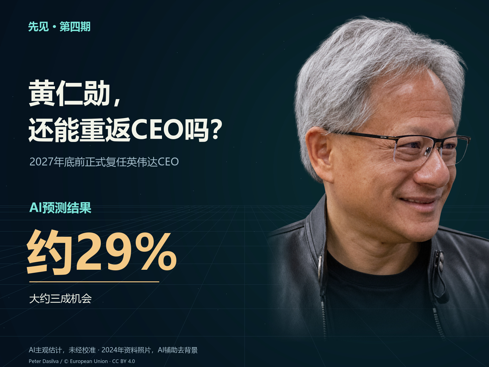

# Xianjian 004: can Jensen Huang return as CEO? A subjective estimate of about 29%

[← Contents](README.en.md) · [中文](issue-004.md)

**The subjective AI estimate of a public, effective NVIDIA CEO reinstatement by the end of 2027 is about 29%, roughly three in ten.**

Information cutoff: **November 16, 2026 at 08:32:11 UTC** (16:32:11 Beijing). Local freeze: **08:40:14 UTC** (16:40:14 Beijing). This is uncalibrated judgment, not demonstrated accuracy. Actual GitHub publication time comes from this [Release](https://github.com/changyicheng1234/xianjian/releases/tag/episode-004-20261116-v2)'s `published_at`, not the earlier local timestamp.

## Why is a return possible?

**The founder's experience and relationships may retain value.** His technical judgment, team cohesion and industry ties could give the board a reason to reconsider if it believes his leadership would benefit the company. This is AI analysis, not a claim that directors support reinstatement. NVIDIA acknowledged his contributions while appointing an interim CEO and starting a permanent succession search ([official announcement](https://nvidianews.nvidia.com/news/nvidia-announces-ceo-transition)).

**There is public support and an unfinished succession process.** Technology figures voiced support and some investors asked that a return remain an option. These do not control the appointment, but describe a possible mechanism for reconsideration. Petition identities and totals were not independently verified and are not treated as an internal company vote ([AFP](https://origin-zh9p7m-www.afp.com/en/us-treasury-chief-wants-answers-soon-nvidia-0)).

**His willingness has also been reported.** Reuters relayed FT anonymous-source reporting about discussions with confidants and lobbying by allies. It has not been formally confirmed by the company, and multiple rewrites are one originating story ([Reuters relaying FT](https://www.marketscreener.com/news/jensen-huang-discusses-comeback-as-nvidia-ceo-with-allies-ft-reports-ce785ededf8bf423)).

## Why is it still below one half?

Board acceptance remains unestablished. Investigation, governance and outside compliance pressure could impede a return. Treasury Secretary Bessent's call for an outside CEO is pressure, not a finding of wrongdoing or an appointment decision. NVIDIA's statement that it had not formally engaged individual candidates leaves flexibility without proving support for Huang ([AFP](https://origin-zh9p7m-www.afp.com/en/us-treasury-chief-wants-answers-soon-nvidia-0), [Bloomberg public excerpt](https://news.bloomberglaw.com/corporate-governance/nvidia-says-speculation-on-new-ceo-candidates-is-premature)).

A stable permanent replacement or only an advisory/director/technical role can still leave the CEO-return event as NO.

## Resolution

| Item | Rule |
| --- | --- |
| YES | After his November 2026 resignation, publicly appointed and taking office as NVIDIA CEO, interim CEO or co-CEO before the deadline; a subsequent departure still counts |
| NO | No qualifying appointment before the deadline; announcing an appointment effective in 2028 does not qualify |
| Exclusive deadline | January 1, 2028 00:00 America/New_York; 05:00 UTC; 13:00 Beijing |
| Excluded | Only director, chair, adviser or technical roles; event appearances, share ownership or informal influence |
| Sources | Authorized company announcement and SEC filing first; then direct verification by independent reliable reporting |

## Three-scene image post

[Scene 1: estimate](images/issue-004-scene-1.png) · [Scene 2: core reason](images/issue-004-scene-2.png) · [Scene 3: return path](images/issue-004-scene-3.png)

[4:3 landscape cover](images/issue-004-cover.jpg) · [3:4 portrait cover](images/issue-004-cover-3x4.jpg) · [Short Chinese social copy](../episodes/004-huang-return-2027/social-copy.zh.txt)

## Key sources

1. [NVIDIA CEO transition](https://nvidianews.nvidia.com/news/nvidia-announces-ceo-transition), November 12, 2026: resignation, interim leadership and permanent search.
2. [SEC Form 8-K, Item 5.02](https://www.sec.gov/Archives/edgar/data/1045810/000104581026000082/nvda-20261111.htm), published November 12: November 11 effective resignation and interim appointment.
3. [Independent NVIDIA directors](https://nvidianews.nvidia.com/news/statement-from-the-independent-members-of-the-nvidia-board), November 10: independent counsel appointment, not final findings.
4. [AFP](https://origin-zh9p7m-www.afp.com/en/us-treasury-chief-wants-answers-soon-nvidia-0), November 16: support, investor requests and outside pressure.
5. [Reuters relaying FT](https://www.marketscreener.com/news/jensen-huang-discusses-comeback-as-nvidia-ceo-with-allies-ft-reports-ce785ededf8bf423), November 15: anonymous-source comeback reporting; FT original unavailable.
6. [Bloomberg](https://news.bloomberglaw.com/corporate-governance/nvidia-says-speculation-on-new-ceo-candidates-is-premature), November 13: public excerpt and quoted company statement only; paid continuation not read.

Method, frozen record and photo attribution

Six actual host-session retrieval/review phases were processed through the existing engine's evidence validation, deduplication and probability accounting. The native CLI did not start in the restricted environment; actual session model identifier is unavailable. Do not interpret this as six successful native model research rounds, empirical calibration, a blind benchmark or demonstrated superiority. Standalone presentation does not alter calculation provenance or freeze time. Full research/logs, video, music and editing project remain local.

- [Reduced prediction record](../episodes/004-huang-return-2027/prediction-record.json) and [public freeze copy](../episodes/004-huang-return-2027/prediction-freeze.json). These are reduced derivatives, not byte-identical private originals; source hashes are retained.
- This [Release](https://github.com/changyicheng1234/xianjian/releases/tag/episode-004-20261116-v2) archives the current version. The main-branch article and contents present it as current; historical Git and immutable Releases provide provenance, not a probability comparison in this article.
- Portrait: Peter Dasilva / © European Union, [Wikimedia Commons](https://commons.wikimedia.org/wiki/File:Jensen_Huang_(cropped)_(2024).jpg), [CC BY 4.0](https://creativecommons.org/licenses/by/4.0/), May 13, 2024 archival photograph. AI-assisted background extraction, cropping, layout and motion compositing; not a reinstatement scene.
- The creator plans Douyin/Bilibili video and Xiaohongshu image posts; platform URLs and actual public timestamps have not been independently verified.

[← Contents](README.en.md)
