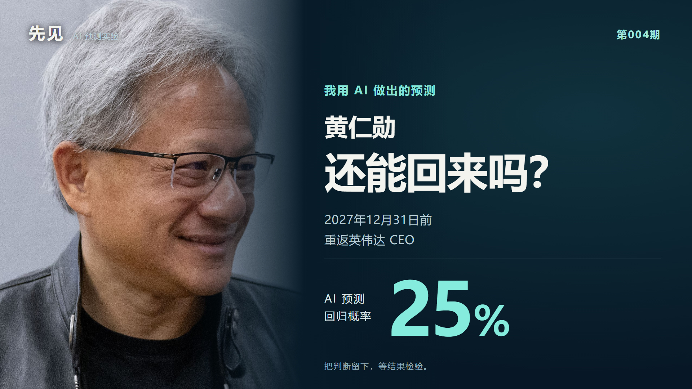

# Xianjian · Episode 004: Could Jensen Huang return? A subjective 25%

[← Contents](README.en.md) · [中文](issue-004.md)

**The frozen AI-assisted judgment assigns a 25% probability that Jensen Huang will again become NVIDIA CEO by the end of 2027, and 75% that he will not.** The video expresses hope for a return; that hope is separate from the probability judgment.

## Question and timing

After his November 2026 resignation, will he again be formally appointed NVIDIA Corporation's permanent, interim or co-CEO before 00:00 on January 1, 2028 in America/New_York? The appointment must be effective and publicly confirmed before that cutoff. A qualifying appointment still counts if he subsequently leaves again.

Board, chair, advisory or technical roles, keynote appearances, shareholdings and informal influence do not count. An appointment announced in 2027 but effective only in 2028 does not qualify.

- Information cutoff: **2026-11-13 04:04:02 UTC**, or 12:04:02 Beijing time.
- Local freeze: **2026-11-13 04:05:40 UTC**, or 12:05:40 Beijing time.
- Exclusive resolution cutoff: **2028-01-01 05:00 UTC**, or 13:00 Beijing time.
- Actual GitHub publication: consult this [Release's published_at](https://github.com/changyicheng1234/xianjian/releases/tag/episode-004-20261113-v1). Local freeze time does not establish earlier public availability.
- Outcome: unresolved at publication.

## Why a return remains possible

The founder's technical judgment, relationships and importance to staff or customers may create reasons to reconsider the CEO position. That value could also be retained through non-CEO roles, which would resolve this question NO.

Altman's OpenAI return illustrates the importance of staff and partner support. Josh James's Domo return after roughly a year shows that leaving both CEO and board positions does not make a short-term comeback impossible. Comparable public mobilization for Huang's reinstatement has not been established.

NVIDIA's interim succession arrangement leaves future decisions open, but the company is also searching for a permanent successor. An interim CFO replacement is not evidence that a seat is being held for the former CEO.

## Why the main estimate remains 25%

Governance, investigation and external-relationship obstacles must fall to a level acceptable to the board. Earlier board support predates the resignation; it is not subsequent endorsement of reinstatement. An investigation is neither a finding of misconduct nor evidence that the concerns have already been resolved.

The roughly thirteen-month horizon is short. A stable permanent successor, Huang's own plans, or cooperation without a CEO appointment could all prevent a qualifying return. The strongest challenge to 25% would be concrete favorable investigative or governance developments accompanied by credible board, staff or shareholder support for reinstatement. Internal findings, board intentions, his willingness and the full succession candidate list were not obtained.

## What the historical cases do and do not show

| Case | Useful mechanism | Material difference |
| --- | --- | --- |
| Sam Altman / OpenAI | Rapid reinstatement with organizational and partner support | Different governance; equivalent NVIDIA support has not been established |
| Steve Jobs / Apple | A founder's value can be reassessed during company difficulties | Roughly twelve years away; he had not been Apple's CEO before leaving in 1985 |
| Brian Krzanich / Intel | Chipmaker, CEO and board exit, CFO appointed interim CEO | Not a founder; Intel's confirmed policy findings cannot be transferred to Huang |
| Josh James / Domo | A return after approximately one year | Majority voting control, company scale and governance arrangements differ |
| Howard Schultz / Starbucks | Interim CEO reappointment can count under this question | A different departure context, not a comparable scandal-return success count |

These cases explain mechanisms. Their selected success frequency was not used as the forecast probability; no sufficiently matched historical base-rate sample was obtained.

## Method, versions and limits

The same AI assistant reviewed the evidence and assigned subjective conditional parameters: 55% that the relevant obstacles become sufficiently acceptable before the deadline, then 45% that an actual CEO appointment is chosen, accepted, effective and public before the deadline, conditional on that first gate. Their product is 24.75%, rounded to 25%. The gates are not assumed independent.

This is not an empirically calibrated statistical estimate. The approximate 15%–40% subjective sensitivity range is not a confidence interval. An earlier conversation draft gave 30% without an independently timestamped freeze; the frozen review gave 25%. That five-point difference is smaller than the precision the evidence supports. The video and this publication preserve the frozen 25%; editing did not rerun the prediction.

Market search displays were encountered during research, but full rules and contemporaneous executable quotes were not verified. No matched market comparison, strict blindness, proven accuracy or AI outperformance is claimed.

## Key sources

1. [NVIDIA CEO transition announcement](https://nvidianews.nvidia.com/news/nvidia-announces-ceo-transition/) (November 12, 2026): resignation, interim succession and permanent successor search.
2. [SEC 8-K, Item 5.02](https://www.sec.gov/Archives/edgar/data/1045810/000104581026000082/nvda-20261111.htm): November 11 board acceptance and immediate effectiveness, distinguished from public disclosure.
3. [Independent NVIDIA board members' statement](https://nvidianews.nvidia.com/news/statement-from-the-independent-members-of-the-nvidia-board) (November 10, 2026): external counsel and investigation process, not final findings.
4. [OpenAI's Altman return announcement](https://openai.com/index/sam-altman-returns-as-ceo-openai-has-a-new-initial-board/) (November 29, 2023): reinstatement and organizational support.
5. [Steve Jobs Archive](https://book.stevejobsarchive.com/): the departure, return and interim CEO timeline.
6. [Intel's Krzanich resignation and Swan interim appointment](https://www.intc.com/news-events/press-releases/detail/146/intel-ceo-brian-krzanich-resigns-board-appoints-bob-swan) (June 21, 2018): company-specific findings and succession structure.
7. [Domo 2023 proxy statement](https://www.sec.gov/Archives/edgar/data/1505952/000150595223000052/domo-20230508.htm): return and majority voting control.
8. [Domo shareholder consent and board changes](https://www.sec.gov/Archives/edgar/data/1505952/000150595223000012/domoregfd8-kfy23exhibit993.htm) (March 6, 2023): relevant governance arrangements.
9. [Starbucks leadership transition](https://investor.starbucks.com/news/financial-releases/news-details/2022/Starbucks-Announces-Leadership-Transition/default.aspx) (March 16, 2022): Schultz's April 4 interim CEO return.

Records, publication and photo credit

- [Public prediction record](../episodes/004-huang-return-2027/prediction-record.json).
- [Byte-preserved local freeze](../episodes/004-huang-return-2027/prediction-freeze-v2.json), SHA256 `312874bcc87dafdaaa91bc2f41ee9cfe98ef9fe12219898d22aaf2ab00e422c3`. Its unpublished/unproduced flags describe the original freeze, not the present production status.
- [Immutable episode Release](https://github.com/changyicheng1234/xianjian/releases/tag/episode-004-20261113-v1). Actual publication time is a GitHub platform record, distinct from the local freeze. Public video-platform publication has not been established.
- Full caches, internal logs, video, music and editing projects remain local. Future revisions and resolution will be separate records.
- Cover photo: Peter Dasilva / © European Union, via [Wikimedia Commons](https://commons.wikimedia.org/wiki/File:Jensen_Huang_(cropped)_(2024).jpg), [CC BY 4.0](https://creativecommons.org/licenses/by/4.0/). Taken May 13, 2024; cropped and typeset, not an actual reinstatement photograph.

