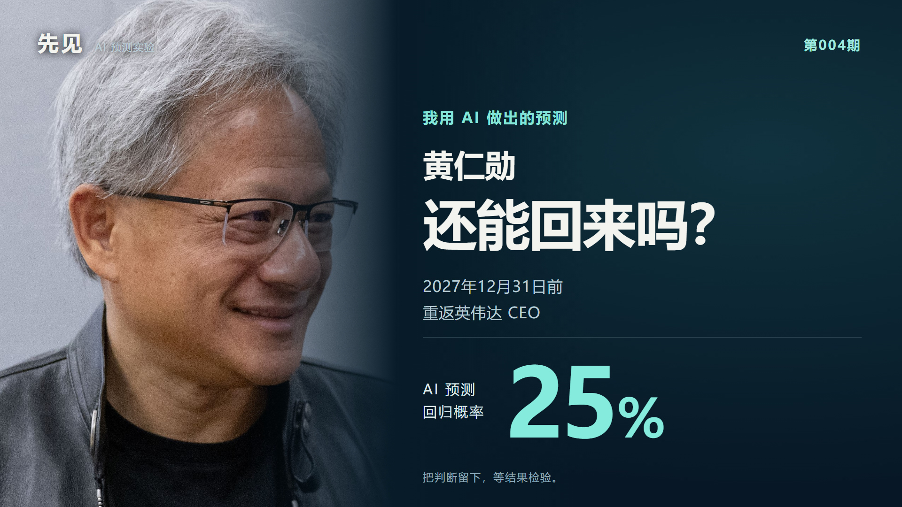

# 先见系列（第004期）：黄仁勋还能回来吗？AI给出25%

[← 返回目录](../README.md) · [English](issue-004.en.md)

**截至2026年11月13日本地研究冻结，我用AI给出的主观判断是：黄仁勋在2027年底前重新出任英伟达CEO的概率约25%，不复任约75%。**

期待他王者归来，是这期视频的情绪；25%，是这次预测留下的判断。两者分别记录，等待事实检验。

## 预测的究竟是什么？

在2026年11月辞任后，黄仁勋是否会在**美国东部时间2027年12月31日结束前**，再次被正式任命为NVIDIA Corporation的CEO。正式CEO、临时CEO和共同CEO都计入；任命必须在截止前已经生效并公开确认，之后再次离任仍计YES。

仅任董事、董事长、顾问或技术职务，回到发布会，继续持股或保有影响力，都不算本题的“回归”。只宣布2028年才生效的任命也不计入。

| 项目 | 本期记录 |
| --- | --- |
| AI主观概率 | 复任25%；不复任75% |
| 资料截止（北京时间） | 2026年11月13日12:04:02 |
| 本地冻结（北京时间） | 2026年11月13日12:05:40 |
| 截止时刻（不含） | 美东2028年1月1日00:00；北京时间当日13:00 |
| GitHub实际公开时间 | 以本期[Release的published_at](https://github.com/changyicheng1234/xianjian/releases/tag/episode-004-20261113-v1)为准；本地冻结不等于此前公开 |
| 当前结果 | 发布时尚未结算 |

## 为什么仍然有回归的可能？

**创始人的经验和关系仍有价值。** 如果公司未来需要他的技术判断、团队凝聚力或客户关系，董事会可能重新权衡由谁担任CEO。但“需要他”不自动等于“让他重新当CEO”，顾问和技术合作也是替代路径。

**短期复任确实存在先例。** 奥特曼的回归展示了团队和合作伙伴支持的作用；Domo的Josh James在约一年后重新担任CEO，说明同时离开CEO与董事职务也不使短期回归变为零可能。反过来，没有取得英伟达存在同等复任动员的证据，不能把别人的路径当成已经发生在这里。

**临时CEO让继任安排尚有后续。** 这给不同管理方案留下空间，但公司也在寻找永久继任者。CFO临时代任既可能是过渡安排，也可能通向稳定的新领导层，不能解读为“替老黄留位置”。

## 为什么主判断仍然只有25%？

**治理与调查方面的障碍需要具体进展。** 董事会此前的支持早于辞任，不能倒写成辞任后支持复任。调查启动不等于指控已成立，也不等于问题已经解决。正式回归仍需要董事会接受其重新担任CEO。

**期限只有约13个月，竞争路径很多。** 永久继任者稳定履职、本人另有安排，或者公司只恢复非CEO合作，都可能使这个具体问题最终为NO。

最强反证是：如果调查与治理问题出现具体有利进展，同时核心团队、重要股东或董事会明确推动复任，当前25%就可能低估其机会。本期没有取得调查最终结论、董事会内部意向、本人复任意愿或完整继任名单。

## 奥特曼、乔布斯等案例怎么参考？

| 案例 | 对本题有用的地方 | 不能直接外推的地方 |
| --- | --- | --- |
| Sam Altman / OpenAI | 技术公司关键人物可借团队、合作方支持迅速复任 | 公司治理结构不同；不能据此假定英伟达已有相同规模的支持 |
| Steve Jobs / Apple | 创始人的价值可能在公司困难时被重新评价 | 相隔约12年；1985年离开前并非苹果CEO，严格说不是CEO复任样本 |
| Brian Krzanich / Intel | 芯片企业CEO及董事退出、CFO临时代任，结构更接近 | 他不是创始人；Intel确认的自身政策违规不能用于认定黄仁勋存在相同违规 |
| Josh James / Domo | 约一年内回到CEO职位的先例 | 多数投票权、公司规模和董事调整条件与英伟达不同 |
| Howard Schultz / Starbucks | 临时CEO也可能构成合格的复任 | 离任背景不同，不能作为类似争议后复任的成功计数 |

这些案例用来辨别机制与差异，**没有按“几个回来了、几个没回来”计算25%**；未取得同时匹配人物、离任背景、公司类型和期限的充分样本。

## 25%是怎样得到的？

这是同一AI助手复核证据后的主观条件概率分解：

- 截止前，治理、调查及外部关系方面的障碍下降到董事会可以接受其重新任CEO的程度：主观约55%。
- 在上述条件成立时，董事会最终选择他、他本人接受，任命按期生效并公开：主观约45%。

55% × 45% = 24.75%，取整为25%。第二项以第一项为条件，未假设独立。算术只是把判断展开，**不证明参数准确，也不是经过历史校准的统计模型**。主观敏感性范围约15%—40%，不是置信区间。

对话初稿曾给30%，没有独立时间戳冻结；本次复核调整为25%，并保留修订原因。25%与30%的差别低于当前证据可支持的精度，不称更准确。视频和本次发布均引用已冻结的25%，没有因剪辑重新预测。

研究过程中接触过预测市场搜索摘要，但完整结算规则及同时刻可执行报价未核实。本题不作市场胜负对照，也不声称盲测或AI优于市场。

## 关键来源

1. [NVIDIA正式CEO交接公告](https://nvidianews.nvidia.com/news/nvidia-announces-ceo-transition/)（2026-11-12）：辞任、Colette Kress临时接任及永久继任者搜寻。公开公告日与生效日分开记录。
2. [SEC 8-K，Item 5.02](https://www.sec.gov/Archives/edgar/data/1045810/000104581026000082/nvda-20261111.htm)（2026-11-12公开）：董事会11月11日接受辞呈及立即生效，不是保留CEO头衔休假。
3. [NVIDIA独立董事声明](https://nvidianews.nvidia.com/news/statement-from-the-independent-members-of-the-nvidia-board)（2026-11-10）：外部律师与调查程序，不当作最终调查结论。
4. [OpenAI：Sam Altman returns as CEO](https://openai.com/index/sam-altman-returns-as-ceo-openai-has-a-new-initial-board/)（2023-11-29）：正式复任与团队、合作伙伴支持，说明一条可能机制。
5. [Steve Jobs Archive](https://book.stevejobsarchive.com/)：档案时间线与当事人口述，核对1985年离开、1996年回归和1997年任临时CEO的差异。
6. [Intel：Krzanich辞任、Swan临时接任](https://www.intc.com/news-events/press-releases/detail/146/intel-ceo-brian-krzanich-resigns-board-appoints-bob-swan)（2018-06-21）：更接近的公司与接班结构；Intel自身政策事实只限该公司。
7. [Domo 2023年代理声明](https://www.sec.gov/Archives/edgar/data/1505952/000150595223000052/domo-20230508.htm)：复任背景与多数投票权，说明控制权差异。
8. [Domo股东书面同意及董事调整文件](https://www.sec.gov/Archives/edgar/data/1505952/000150595223000012/domoregfd8-kfy23exhibit993.htm)（2023-03-06）：约一年复任案例的治理安排。
9. [Starbucks领导层交接公告](https://investor.starbucks.com/news/financial-releases/news-details/2022/Starbucks-Announces-Leadership-Transition/default.aspx)（2022-03-16）：Schultz于4月4日正式回归担任临时CEO。

冻结记录、公开归档与图片署名

- [公开预测记录JSON](../episodes/004-huang-return-2027/prediction-record.json)：问题、结算条件、概率、时间、方法与版本说明。
- [原始本地冻结文件](../episodes/004-huang-return-2027/prediction-freeze-v2.json)：逐字节保留。SHA256：`312874bcc87dafdaaa91bc2f41ee9cfe98ef9fe12219898d22aaf2ab00e422c3`。其中“未发布／未制作”是冻结当时状态，当前制作与本次归档说明另见公开记录。
- [本期独立Release](https://github.com/changyicheng1234/xianjian/releases/tag/episode-004-20261113-v1)：公开时间以GitHub平台记录为准。本地已制作视频不等于已在视频平台公开发布。
- 完整网页缓存、研究日志、视频、配乐及剪映工程留在本地；修订或未来结算另建记录，保留本次判断。
- 封面沿用往期照片：Peter Dasilva / © European Union，经[Wikimedia Commons](https://commons.wikimedia.org/wiki/File:Jensen_Huang_(cropped)_(2024).jpg)，[CC BY 4.0](https://creativecommons.org/licenses/by/4.0/)。2024年5月13日资料照片，已裁剪排版，不是真实复任现场。

[← 返回历期目录](../README.md)
