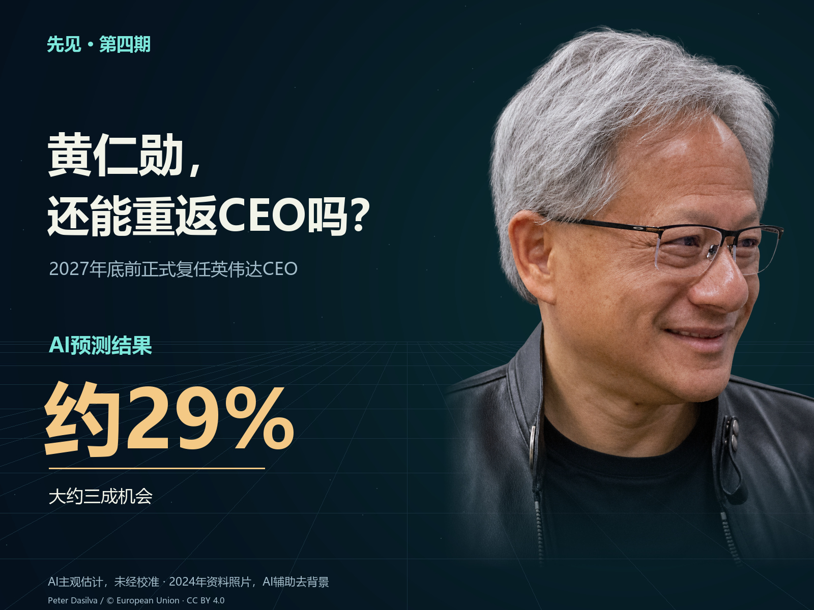

# 先见系列（第004期）：黄仁勋还能重返CEO吗？AI给出约29%

[← 返回目录](../README.md) · [English](issue-004.en.md)

**AI主观预测：黄仁勋在2027年底前正式复任英伟达CEO的概率约29%，大约三成。**

资料截至**2026年11月16日北京时间16:32:11**，本地冻结于当日**16:40:14**。这是主观估计，未经历史校准，不代表准确率。GitHub实际公开时间以[本期Release](https://github.com/changyicheng1234/xianjian/releases/tag/episode-004-20261116-v2)的`published_at`为准，本地冻结不等于此前已公开。

## 为什么仍有回归的机会？

**创始人的经验和关系仍有价值。** 如果董事会认为公司仍需要他的技术判断、团队凝聚力和行业关系，就有重新考虑他的现实理由。这是AI的分析，不是董事会已经支持复任。公司交接公告肯定其贡献，并宣布临时CEO和永久继任者搜寻安排。[NVIDIA交接公告](https://nvidianews.nvidia.com/news/nvidia-announces-ceo-transition)

**回归有人推动，继任尚未定局。** 科技界人士公开声援，部分投资者呼吁保留回归选项。它们不能代替董事会任命，但与仍在推进的继任安排结合，说明回归路径存在。公开请愿的身份和人数没有独立核验，不把签名当成公司内部投票。[AFP报道](https://origin-zh9p7m-www.afp.com/en/us-treasury-chief-wants-answers-soon-nvidia-0)

**本人意愿也出现线索。** 路透援引《金融时报》匿名人士称，他与亲信讨论回归、盟友组织游说。这仍是未获公司正式确认的报道；多家转述同一稿源，不算多份独立证据。[Reuters转述FT](https://www.marketscreener.com/news/jensen-huang-discusses-comeback-as-nvidia-ceo-with-allies-ft-reports-ce785ededf8bf423)

## 为什么没有判断为更可能发生？

正式复任仍需要董事会接受。调查、治理安排和外部合规压力都可能提高回归成本；财长主张外部新CEO，是压力信号，不是违法认定或董事会决定。公司称尚未正式接洽具体候选，也不能反推董事会愿意让黄仁勋回来。[AFP](https://origin-zh9p7m-www.afp.com/en/us-treasury-chief-wants-answers-soon-nvidia-0) · [Bloomberg公开段落](https://news.bloomberglaw.com/corporate-governance/nvidia-says-speculation-on-new-ceo-candidates-is-premature)

如果其他永久CEO稳定接任，或者只恢复顾问、董事或技术合作，而未在期限内正式任CEO，本题仍为NO。

## 预测的究竟是什么？

| 项目 | 结算口径 |
| --- | --- |
| YES | 2026年11月辞任后，再次被任命为NVIDIA正式、临时或共同CEO，并在截止前公开确认且已生效；之后再次离任仍计YES |
| NO | 截止前未发生合格复任；只宣布2028年才生效的任命不算 |
| 截止时刻（不含） | 美东2028年1月1日00:00；UTC 05:00；北京时间13:00 |
| 不计入 | 仅任董事、董事长、顾问或技术职务；出席发布会、持股或有影响力 |
| 核验优先级 | 公司正式公告、SEC文件；再看相互独立的可靠媒体直接核实 |

## 三幕图文

24秒视频的三幕配图，可直接查看或另存：

[第一幕：预测结果](images/issue-004-scene-1.png) · [第二幕：核心理由](images/issue-004-scene-2.png) · [第三幕：回归路径](images/issue-004-scene-3.png)

[4:3横版封面](images/issue-004-cover.jpg) · [3:4竖版封面](images/issue-004-cover-3x4.jpg) · [小红书短文案](../episodes/004-huang-return-2027/social-copy.zh.txt)

## 关键来源

1. [NVIDIA交接公告](https://nvidianews.nvidia.com/news/nvidia-announces-ceo-transition)（2026-11-12）：辞任、临时CEO与永久继任者搜寻。
2. [SEC 8-K，Item 5.02](https://www.sec.gov/Archives/edgar/data/1045810/000104581026000082/nvda-20261111.htm)（2026-11-12公开）：11月11日生效的辞任及临时接任。
3. [NVIDIA独立董事声明](https://nvidianews.nvidia.com/news/statement-from-the-independent-members-of-the-nvidia-board)（2026-11-10）：聘请独立调查律师，不是最终调查结论。
4. [AFP：US Treasury chief wants answers soon from Nvidia](https://origin-zh9p7m-www.afp.com/en/us-treasury-chief-wants-answers-soon-nvidia-0)（2026-11-16）：支持力量、投资者诉求与外部压力。
5. [Reuters转述FT的回归报道](https://www.marketscreener.com/news/jensen-huang-discusses-comeback-as-nvidia-ceo-with-allies-ft-reports-ce785ededf8bf423)（2026-11-15）：匿名消息线索，非公司公告；FT原文访问受限。
6. [Bloomberg：候选人猜测为时过早](https://news.bloomberglaw.com/corporate-governance/nvidia-says-speculation-on-new-ceo-candidates-is-premature)（2026-11-13）：仅阅读公开段落及公司引语，未读取付费后文。

方法、冻结记录与图片署名

本次实际完成六个会话检索核验阶段，再经现有预测引擎核心记录证据、去重并计算；原生命令在受限环境中未成功启动，实际会话模型标识未知。因此不声称指定模型成功完成六轮原生研究，也不声称经验校准、盲测或优于其他预测。独立节目呈现不改变真实计算来源和冻结时间。完整研究、运行日志、视频、配乐及剪映工程留在本地。

- [精简预测记录](../episodes/004-huang-return-2027/prediction-record.json) · [本次公开冻结副本](../episodes/004-huang-return-2027/prediction-freeze.json)。公开副本已精简，不等同于私有原件逐字节复制；原件哈希在JSON中保留。
- [本期Release](https://github.com/changyicheng1234/xianjian/releases/tag/episode-004-20261116-v2)归档当前版本；主分支文章与目录以此版本为当前展示。历史Git和不可变Release仅用于版本追溯，不作为本文的概率比较。
- 人物照片：Peter Dasilva / © European Union，[Wikimedia Commons](https://commons.wikimedia.org/wiki/File:Jensen_Huang_(cropped)_(2024).jpg)，[CC BY 4.0](https://creativecommons.org/licenses/by/4.0/)，2024年5月13日资料照片。经AI辅助去背景、裁剪排版与动画合成，不是真实复任现场。
- 用户计划在抖音、哔哩哔哩和小红书发布；本资料未独立核验视频平台/图文帖的公开链接或发布时间。

[← 返回历期目录](../README.md)
