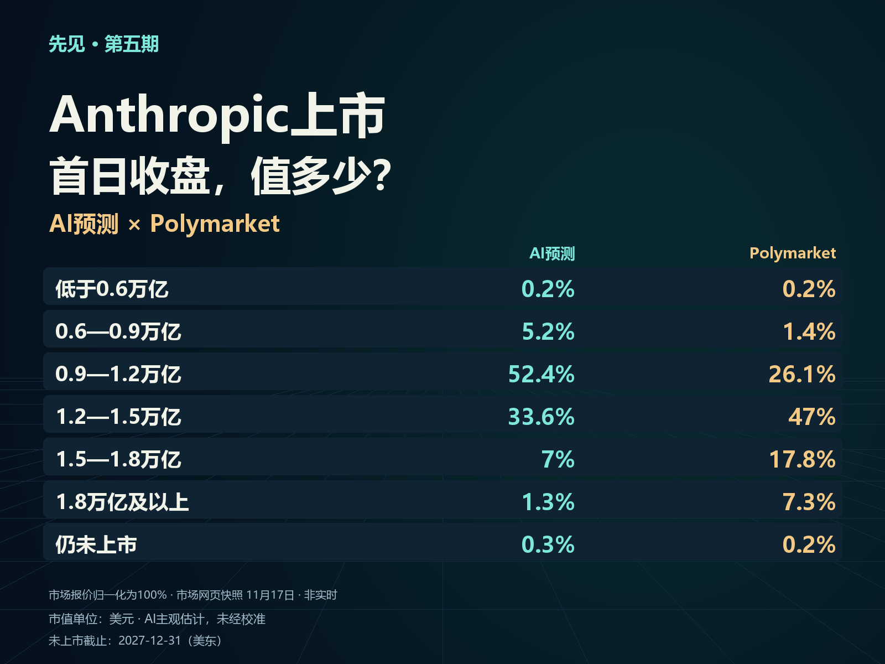

# Prescience 005: Anthropic IPO first-day closing market capitalization

[← Index](README.en.md) · [中文](issue-005.md)

**The AI distribution favors $0.9T–$1.2T (52.4%); the normalized market webpage snapshot favors $1.2T–$1.5T (47.0%).**

| First-day closing market cap | AI estimate | Normalized Polymarket snapshot |
| --- | ---: | ---: |
| Below $0.6T | 0.2% | 0.2% |
| $0.6T–$0.9T | 5.2% | 1.4% |
| $0.9T–$1.2T | 52.4% | 26.1% |
| $1.2T–$1.5T | 33.6% | 47.0% |
| $1.5T–$1.8T | 7.0% | 17.8% |
| $1.8T or more | 1.3% | 7.3% |
| No IPO by Dec 31, 2027 ET | 0.3% | 0.2% |
| **Total** | **100.0%** | **100.0%** |

USD. Lower boundaries inclusive; upper boundaries exclusive. Market cap follows the linked market: official first-day closing price times outstanding shares; exchange data take priority. The no-IPO cutoff is December31,2027,23:59 ET. Abbreviated-session and missing-close rules follow the original market.

Local freeze: 2026-11-17T12:25:37.188998+00:00. Webpage fetched after freeze: 2026-11-17 12:25:39 UTC. Individual quote timestamps are unavailable; this is neither live nor a same-second executable quote. Actual GitHub publication time must be recorded separately.

The market baseline uses YES midpoint=(YES buy ask+100−NO buy ask)/2, normalized across seven exhaustive outcomes. Raw midpoints total102.35%. Largest-remainder rounding preserves a100% displayed sum. [Raw quotes and conversion](../episodes/005-anthropic-ipo-market-cap/market-comparison.json).

Six actual host-session evidence-review phases used the existing predict-raven categorical core for validation and accounting. The requested gpt-6.1-sol/high native CLI failed to start; the actual host model identifier is unavailable. This is not six independent native model runs. Subjective priors/effects are uncalibrated, the expanded library was unavailable, and market quotes had been exposed during topic/rule lookup. No full-blindness or accuracy claim is made. Outstanding and fully diluted share counts must not be mixed; final pricing and exchange counts remain uncertain.

[Forecast record](../episodes/005-anthropic-ipo-market-cap/prediction-record.json).

## Sources

1. [Anthropic S-1/A No.2](https://www.sec.gov/Archives/edgar/data/2130357/000162828026072484/anthropicpbc-sx1ax2.htm) (2026-11-10).
2. [Anthropic IPO 官网](https://ipo.anthropic.com/us/) (2026-11-17访问).
3. [Reuters：订单簿与估值争议](https://www.investing.com/news/stock-market-news/exclusiveinvestors-flock-to-anthropic-ipo-but-question-durability-of-ai-lead-5026644) (2026-11-13).
4. [Jay Ritter IPO Statistics](https://site.warrington.ufl.edu/ritter/files/IPO-Statistics.pdf) (2026-11-05).
5. [美联储金融稳定报告](https://www.federalreserve.gov/publications/files/financial-stability-report-20261113.pdf) (2026-11-13).
6. [Fidelity IPO时间表](https://www.fidelity.com/learning-center/trading-investing/how-to-buy-anthropic-stock) (2026-11-10).
7. [Google N类股购买协议](https://www.sec.gov/Archives/edgar/data/2130357/000162828026072484/exhibit1015-sx1ax2.htm) (2026-11-10).
8. [Polymarket 原题及网页快照](https://polymarket.com/event/anthropic-ipo-closing-market-cap-979) (2026-11-17抓取).
