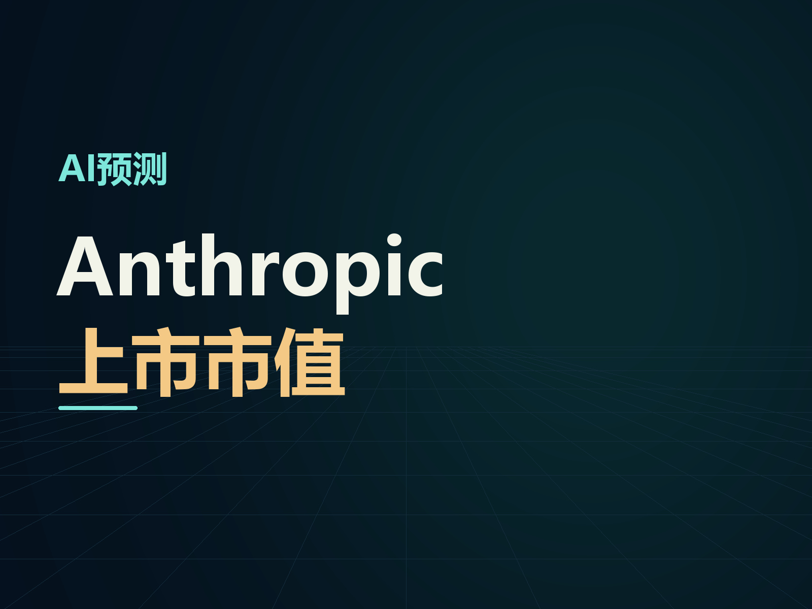

# 先见系列（第005期）：Anthropic上市首日，会值多少？

[← 返回目录](../README.md) · [English](issue-005.en.md)

**AI最看好0.9—1.2万亿美元：52.4%；市场归一化快照最看好1.2—1.5万亿美元：47.0%。**

| 首日收盘市值 | AI预测 | Polymarket快照* |
| --- | ---: | ---: |
| 低于0.6万亿美元 | 0.2% | 0.2% |
| 0.6万亿—0.9万亿美元 | 5.2% | 1.4% |
| 0.9万亿—1.2万亿美元 | 52.4% | 26.1% |
| 1.2万亿—1.5万亿美元 | 33.6% | 47.0% |
| 1.5万亿—1.8万亿美元 | 7.0% | 17.8% |
| 1.8万亿美元及以上 | 1.3% | 7.3% |
| 截至2027年12月31日仍未IPO | 0.3% | 0.2% |
| **合计** | **100.0%** | **100.0%** |

金额单位为美元。各区间含下限、不含上限；“未IPO”以美东2027年12月31日23:59为截止。结算采用首个交易日官方收盘价乘以已发行在外股数，优先交易所官方页面；缩短交易日及无官方收盘价时沿用原题规则。

AI本地冻结：**2026-11-17T20:25:37.188998+08:00**。市场网页于冻结后抓取：**2026-11-17 12:25:39 UTC**。网页报价各自更新时间未提供，不能称实时或同秒价格。GitHub实际公开时间另以发布记录为准；本地冻结不等于已经公开。

*市场按每档YES买价与NO买价反推的YES卖买中点计算，再将七档等比归一化。原中点总和为102.35%；显示按最大余数法保留一位小数，总和100%。这不是平台直接给出的归一化分布，也不是可成交价格。[原始报价与换算](../episodes/005-anthropic-ipo-market-cap/market-comparison.json)。

主观分析主要依据实际已发行股数对应的静态市值、IPO需求和首日涨跌的不确定性；完全稀释估值不可直接代入。已发行股数、最终定价与交易所口径尚可能变化。视频仅展示概率及市场对比。

## 方法与限制

实际完成六个当前会话查源阶段，使用现有predict-raven分类预测核心核验、相关性折减和计算。指定gpt-6.1-sol/high原生命令未成功启动，实际主会话模型标识未提供；不声称该指定模型完成六轮原生研究。起点和证据影响均为AI主观估计、未经校准。扩展资源库不可用；选题与规则检索已暴露市场报价，不是全程盲测。概率合计100%不证明准确率或优于市场。

[精简预测记录](../episodes/005-anthropic-ipo-market-cap/prediction-record.json) · [4:3封面](images/issue-005-cover.jpg) · [3:4封面](images/issue-005-cover-3x4.jpg)

## 主要来源

1. [Anthropic S-1/A No.2](https://www.sec.gov/Archives/edgar/data/2130357/000162828026072484/anthropicpbc-sx1ax2.htm)（2026-11-10）：发行结构、股数、财务和风险；仅核验相关段落和表格，未称全文审计。
2. [Anthropic IPO 官网](https://ipo.anthropic.com/us/)（2026-11-17访问）：计划定价与交易日期，尚附监管条件。
3. [Reuters：订单簿与估值争议](https://www.investing.com/news/stock-market-news/exclusiveinvestors-flock-to-anthropic-ipo-but-question-durability-of-ai-lead-5026644)（2026-11-13）：匿名知情人士报道，不是已确认配售。
4. [Jay Ritter IPO Statistics](https://site.warrington.ufl.edu/ritter/files/IPO-Statistics.pdf)（2026-11-05）：读取表1和表7；历史普通IPO不是本题校准样本。
5. [美联储金融稳定报告](https://www.federalreserve.gov/publications/files/financial-stability-report-20261113.pdf)（2026-11-13）：选读风险摘要和Box5.1；主要信息截点为10月28日。
6. [Fidelity IPO时间表](https://www.fidelity.com/learning-center/trading-investing/how-to-buy-anthropic-stock)（2026-11-10）：券商操作时间表。
7. [Google N类股购买协议](https://www.sec.gov/Archives/edgar/data/2130357/000162828026072484/exhibit1015-sx1ax2.htm)（2026-11-10）：私募配售按最终发行价换算股数。
8. [Polymarket 原题及网页快照](https://polymarket.com/event/anthropic-ipo-closing-market-cap-979)（2026-11-17抓取）：七档结构；报价更新时间未提供，非实时交易数据。
